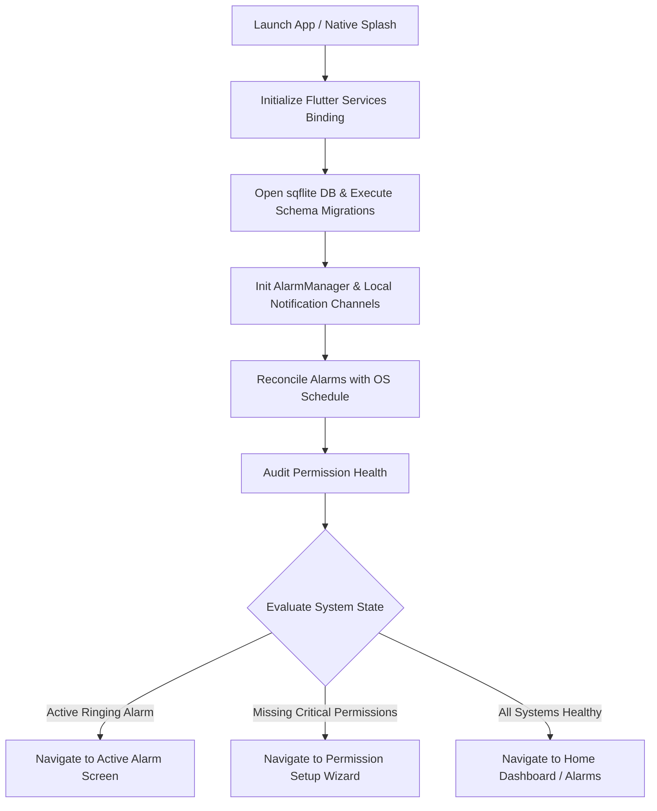

# Super Sleep — Splash Screen Specification

**Product:** Super Sleep  
**Platform:** Android  
**Framework:** Flutter  
**Design direction:** Google-inspired simplicity using Material Design 3  
**Tagline:** *Wake up. Show up. Build your streak.*  
**Document version:** 1.0  

---

## 1. Overview & Purpose

The Splash Screen is the primary entrance to **Super Sleep**. It serves two essential roles:

1. **Brand Identity & User Experience:** Establishing a calm, trustworthy Material Design 3 visual impression with the app icon, title ("Super Sleep"), tagline (*Wake up. Show up. Build your streak.*), and soft tonal background colors.
2. **System Initialization & Routing Pipeline:** Executing mandatory background startup tasks before navigating to the main user interface. This guarantees database readiness, OS alarm schedule reconciliation, permission health checking, and instant deep-link routing if an alarm is actively ringing.

---

## 2. Visual Identity & Design Tokens

The visual layout adheres strictly to the tokens defined in `theme.md` and Google Material Design 3 principles.

### 2.1 Theme Tokens

| Token / Property | Light Theme (`#F8FAFC`) | Dark Theme (`#121212`) | Usage |
|---|---|---|---|
| **Background** | `#F8FAFC` | `#121212` | Full screen background |
| **Primary** | `#2563EB` | `#8AB4F8` | Primary icon accent & loading indicator |
| **Primary Container** | `#DBEAFE` | `#1E3A5F` | Icon background badge |
| **On Background** | `#0F172A` | `#F8FAFC` | App Title text color |
| **On Surface Variant** | `#64748B` | `#B0B0B0` | Tagline text & version label |
| **Streak Accent** | `#F59E0B` | `#FBBF24` | Flame accent inside app icon |
| **Typography (Title)** | Roboto 26 px / Bold (700) | Roboto 26 px / Bold (700) | "Super Sleep" header |
| **Typography (Tagline)** | Roboto 14 px / Regular (400) Italic | Roboto 14 px / Regular (400) Italic | Tagline phrase |
| **Typography (Version)** | Roboto 12 px / Medium (500) | Roboto 12 px / Medium (500) | "v1.0.0" footer |

---

## 3. Screen Structure & Visual Layout

```
SplashScreen (Scaffold)
 └── SafeArea
      └── Column (Main Axis: Center, Cross Axis: Center)
           ├── Spacer (flex: 3)
           ├── Container (App Icon Badge: 72 × 72 dp, Radius: 20 px, SurfaceVariant/PrimaryContainer)
           │    └── Icon (Material Symbols: alarm_on + local_fire_department, 40 dp, Primary)
           ├── SizedBox (height: 24 px)
           ├── Text ("Super Sleep", style: TitleLarge, 26 px, Bold)
           ├── SizedBox (height: 8 px)
           ├── Text ("Wake up. Show up. Build your streak.", style: BodyMedium, 14 px, Italic)
           ├── Spacer (flex: 2)
           ├── CircularProgressIndicator (strokeWidth: 3 px, size: 24 × 24 dp)
           ├── SizedBox (height: 12 px)
           ├── Text ("Loading alarm engine...", style: BodySmall, 12 px, Supporting Text)
           ├── SizedBox (height: 32 px)
           └── Text ("v1.0.0", style: LabelSmall, 12 px)
```

### 3.1 Layout Rules

- **Minimal & Tonal:** No heavy elevation or drop shadows.
- **Responsive Spacing:** Uses 8 px base spacing system (8 px, 12 px, 24 px, 32 px).
- **Touch Targets:** Non-interactive presentation screen; smooth non-blocking transition.

---

## 4. Technical Initialization Pipeline

During splash screen display, an asynchronous initialization sequence is performed before screen transition.



### 4.1 Initialization Steps

1. **Database Setup (`DatabaseProvider`):**
   - Open `sqflite` database once.
   - Run schema migrations (`onUpgrade`).
2. **Alarm Engine Setup (`AndroidAlarmScheduler` & `NotificationService`):**
   - Initialize `android_alarm_manager_plus` and `flutter_local_notifications`.
   - Ensure high-importance notification channel with alarm audio usage is configured.
3. **Alarm Reconciliation (`AlarmScheduler.rescheduleAll()`):**
   - Read all enabled alarms from SQLite database.
   - Re-register exact alarms with stable integer IDs.
   - Log any missed alarms if device was powered off during scheduled time.
4. **Permission Health Audit (`PermissionService`):**
   - Verify status of Exact Alarms (`SCHEDULE_EXACT_ALARM`), Full-Screen Intent (`USE_FULL_SCREEN_INTENT`), Post Notifications (`POST_NOTIFICATIONS`), and Battery Optimization Exemption.
5. **Ringing / Deep Link Detection:**
   - Detect if launch was triggered by full-screen intent or alarm callback.

---

## 5. State Machine & Navigation Routing

| System State | Condition | Target Route |
|---|---|---|
| **Ringing Alarm** | App launched from active alarm event or full-screen intent | `/ringing` (Active Alarm Screen) |
| **Missing Permissions** | First launch OR missing exact alarm / notification permissions | `/permissions/wizard` (Permission Wizard) |
| **Normal Healthy** | All permissions granted, no active ringing alarm | `/alarms` (Home Dashboard Shell) |
| **Database Error** | Database lock or schema issue | `/alarms` (Home with persistent error alert) |

---

## 6. Animation & Motion Design

- **Entrance Motion:** Fade-in of logo badge and text elements (150–200 ms, `Curves.easeOut`).
- **Loading Motion:** Material 3 indeterminate circular progress indicator (`#2563EB` / `#8AB4F8`).
- **Exit Motion:** Smooth cross-fade transition (150–250 ms) to destination route.
- **Timing Constraint:** Minimum visible duration: 800 ms (prevents visual flash); maximum execution timeout: 2000 ms.

---

## 7. Android Native Integration

- **Android 12+ Splash API (`SplashScreen`):** Configured via `MainActivity.kt` and `styles.xml` using `Theme.SplashScreen` matching theme tokens `#F8FAFC` (Light) and `#121212` (Dark).
- **Smooth Hand-off:** Seamless transition from Android system splash screen to Flutter `SplashScreen` widget.

---

## 8. Error Handling & Edge Cases

1. **Slow Storage / DB Timeouts:** 2.5 second fallback timer ensures app proceeds to Home screen even if storage response is delayed.
2. **Device Reboot Alarm Launch:** Direct instant routing to `/ringing` within 300 ms.
3. **Revoked Permissions:** Audit step catches user settings changes while backgrounded and routes to Permission Wizard.
